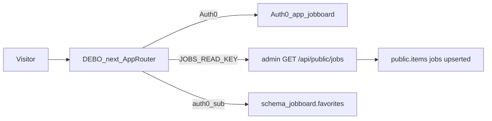

# Sprint Tiny Bear — job board

Status: **grill locked** — ticket backlog in [`00-INDEX.md`](./00-INDEX.md).  
Canon: [`../../../../SOLINET-SHARED-SUPABASE.md`](../../../../SOLINET-SHARED-SUPABASE.md) (S0–S12).

---

## Frame

### Problem

Les offres scrapées (`public.items`, `project=jobs`) ne sont visibles que dans l’admin opérateur. Il n’existe pas de site public Solinet pour les parcourir, les filtrer, ni les sauver. L’ancien DEBO MERN (tenders / Mongo) n’est pas ce produit.

### Outcome

Un visiteur ouvre le **job board** (Next.js, repo DEBO, branche `next`) :

1. **Landing** `/` (chrome Debo Info caramel, CTA vers les offres).  
2. **Liste** `/jobs` filtrée (titre, company, location, date) paginée via l’API publique.  
3. **Fiche** `/jobs/[id]` avec `description_md`.  
4. **Auth0** + **favoris** save/unsave (`jobboard.favorites`, `auth0_sub`).

---

## Success criteria (end of sprint)

- Branche `next` : App Router à la racine DEBO ; plus de CRA/Express sur cette branche.
- `GET /api/public/jobs` (AI-scrapper) refuse sans Bearer, ignore `project` client, ne renvoie que `jobs` + `upserted`.
- Liste + fiche branchées sur cette API (query `q`, `company`, `location`, `publish_after`, `limit`, `offset`).
- Login Auth0 (nouvelle Application, tenant Solinet).
- SQL `jobboard.favorites` versionné dans `DEBO/docs/sql/` ; save/unsave filtré sur `sub`.
- Registre S8 : `jobboard` → repo DEBO.
- UI Debo Info **caramel/marron** (pas le FitApp bleu-violet) via **shadcn** : landing `/`, overview `/jobs`, fiche `/jobs/[id]`.

**Not** required: hide offre, paiement, enqueue scrape, schema `debo` / tenders UI, copie des items hors `public.items`.

---

## Locked decisions (grill)

| Topic | Lock |
|--------|------|
| Product app | **`jobboard`** — scraper project **`jobs`**, not tenders |
| Git | Repo **DEBO**, branch **`update-next`** (grill: `next`), App Router **at repo root** (`main` MERN frozen) |
| Ticket files | This folder ; IDs **`TB-*`** |
| Catalogue | AI-scrapper `GET /api/public/jobs` + Bearer `JOBS_READ_KEY` (S6) |
| Filters | API query params, **not** client-side filter of a full dump |
| Pagination | `limit` / `offset` |
| Auth | Auth0 visitors ; **not** scrape Supabase Auth (S2) |
| Favorites | save/unsave only ; schema `jobboard` ; column `auth0_sub` |
| Layers | `lib/api` → hooks → `*-view` ; fixtures in view tests |
| UI | Debo Info caramel (`#803D3B` / `#FAF4EC`) ; **shadcn** in `components/ui/` ; not FitApp `#4294E3` |
| Routes | `/` landing ; `/jobs` list ; `/jobs/[id]` detail |
| Out | Hide, payments, `SCRAPER_RUN_KEY`, third Supabase instance (S0, S7) |

---

## Product spine

